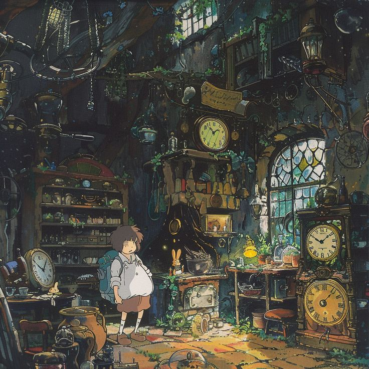

<!-- =====================================
     KEERTHANA'S LITTLE WORKSHOP
     A COZY ENGINEERING JOURNAL
===================================== -->

<h1>Welcome to My Little Workshop 🍂</h1>

<i>Mechanical Engineer · Developer · Curious Creator</i>

Building things, breaking things,
and learning how the world works.

  ﹏﹏﹏﹏﹏﹏﹏﹏﹏﹏ ✦ ﹏﹏﹏﹏﹏﹏﹏﹏﹏﹏

<!-- =====================================
     THE LITTLE WORKSHOP — JOURNAL BEGINS
===================================== -->

  ✿ &nbsp; A SMALL CORNER OF CURIOSITY &nbsp; ✿

  <strong>Welcome to My Little Workshop 🍂</strong>

<i>Mechanical Engineer · Developer · Curious Creator</i>

  A place for little ideas, ambitious experiments,
  mechanical wonders and everything in between.

  Currently making things, learning things, and occasionally making a mess.

 

<!-- ABOUT ME -->

<table width="100%">
<tr>
<td>

<h3>🍁 A Little About Me</h3>

Hello there! I'm Keerthana, a Mechanical Engineering
student with a curious mind and a soft spot for
technology, design and creativity.

I love exploring the space where engineering meets
imagination. One day it might be a mechanical system,
the next a little website or an entirely new idea.

I believe learning should feel like an adventure,
and every unfinished project is simply another
story waiting to happen.

  — A note from the maker ✍️

</td>
</tr>
</table>

 

<!-- DREAMS AND MACHINES -->

<h3>🌿 Somewhere Between Dreams & Machines</h3>

<table width="100%">
<tr>
<td width="55%" valign="middle">

I believe every little idea has the potential
to become something wonderful.

You'll probably find me somewhere between
a pile of engineering sketches, unfinished
projects, books and a cup of coffee.

I'm still figuring things out, one experiment
at a time. And honestly, that's the fun part.

<i>
"A curious mind will always find a way
to build something extraordinary."
</i>

</td>

<td width="45%" align="center" valign="middle">

</td>
</tr>
</table>

 

<!-- INTERESTS -->

<h3>🌼 Things That Catch My Curiosity</h3>

<table width="100%">
<tr>
<td width="50%" valign="top">

⚙️ <strong>Mechanical Engineering</strong>

🤖 <strong>Robotics & Automation</strong>

📐 <strong>CAD & 3D Modelling</strong>

</td>
<td width="50%" valign="top">

🧪 <strong>Engineering Simulations</strong>

💻 <strong>Web Development</strong>

🎮 <strong>Game Development</strong>

</td>
</tr>
</table>

 

<!-- TOOLBOX -->

<h3>🧰 The Tools on My Workbench</h3>

  Little tools helping me turn imagination into reality.

 

  <strong>✦ ENGINEERING & 3D DESIGN ✦</strong>

  
  
  

 

  <strong>✦ WEB & DEVELOPMENT ✦</strong>

  

 

  <strong>✦ GAME & CREATIVE DEVELOPMENT ✦</strong>

  

 

  From mechanical sketches to digital worlds — always something to create. 🌱

 

<!-- PROJECTS -->

<h3>🏡 Little Things I've Been Building</h3>

  Ideas from my notebook, slowly becoming reality.

 

<table width="100%">
<tr>
<td width="100%" align="center">

<h3>🌿 ELEMENTA</h3>

<i>Explore the Elements</i>

An interactive educational periodic table
designed to make exploring chemical elements
engaging and accessible.

  ✦ COMPLETED PROJECT

<a href="https://keerthananilkumar.github.io/ELEMENTA/#unlock-slider">VISIT ELEMENTA ↗</a>

</td>
</tr>

<tr>
<td align="center">

 

<h3>⚙️ KINETRA</h3>

<i>Engineering in Motion</i>

A browser-based engineering playground
exploring mechanical systems, simulations
and the fascinating world of motion.

  ✦ CURRENTLY IN DEVELOPMENT

<a href="https://keerthananilkumar.github.io/KINETRA/">VISIT KINETRA ↗</a>

</td>
</tr>
</table>

 

  <i>Every creation starts with a little curiosity. 🍂</i>

 

<!-- THE LEARNING GARDEN -->

<h3>🌱 The Learning Garden</h3>

  A little progress every day. A little curiosity in everything.

 

<table width="100%" border="0">
<tr>
<td width="58%" valign="top">

<table width="100%">
<tr>
<td valign="top">

<h4>📖 Currently Studying</h4>

✦ HTML, CSS & JavaScript

✦ Web development

 
Learning to bring ideas to life on the web.

</td>
<td valign="top">

<h4>⚙️ Engineering Desk</h4>

✦ AutoCAD

✦ SolidWorks

✦ Engineering design & simulation

 
Turning concepts into designs and models.

</td>
</tr>
<tr>
<td colspan="2" valign="top">

<h4>🎮 The Curiosity Corner</h4>

✦ Godot & game development

✦ Interactive experiences

✦ Exploring creative ways to build things

 
Because not every experiment needs to stay on paper.

</td>
</tr>
</table>

</td>

<td width="42%" valign="middle" align="center">

</td>
</tr>
</table>

 

  <i>Still learning, still experimenting, 
  still becoming.</i>
   
  🌿 🌸 🌿

<!-- GITHUB STATISTICS -->

<h3>📊 Numbers From My Little Workshop</h3>

  A few numbers telling the story of my journey so far.

 

  

  

<!-- PHILOSOPHY -->

<h3>☕ A Little Philosophy</h3>

 

<i>
"I believe every great invention begins with a little curiosity,
a messy notebook, and the courage to ask
what if?"
</i>

  

I'm here to understand how things work, imagine how they could be better,
and turn little ideas into things that actually exist.

Somewhere between machines, code, creativity, and endless curiosity,
I'm building my own little corner of the world.

 

<b>Still learning. Still building. Still dreaming. 🌱</b>

  

Made with curiosity, a little chaos, and lots of coffee. 🤎

<!-- END PHILOSOPHY -->

<!-- FOOTER -->

  ✿ &nbsp; ✿ &nbsp; ✿

<strong>Thanks for wandering through my little corner of the internet.</strong>

  Made with curiosity, coffee and a little bit of imagination. 🤎

