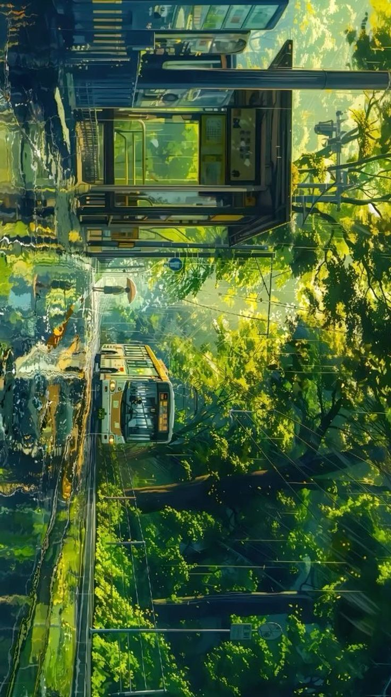

<!-- =====================================
     KEERTHANA'S LITTLE WORKSHOP
     A COZY ENGINEERING JOURNAL
===================================== -->

  

<h1>Welcome to My Little Workshop 🍂</h1>

  <i>Mechanical Engineer · Developer · Curious Creator</i>

  Building things, breaking things,
  and learning how the world works.

---

<!-- ABOUT ME -->

<h2>🍁 A Little About Me</h2>

  Hey! I'm Keerthana, a Mechanical Engineering
  student with a curiosity for technology,
  design and creativity.

  I love exploring the intersection of
  engineering, programming and imagination.
  From mechanical systems to digital worlds,
  there's always something new to build.

---

<!-- THE LITTLE INVENTOR SECTION -->

<table>
<tr>
<td width="65%" valign="middle">

<h3>🌿 Somewhere Between Dreams & Machines</h3>

I believe every little idea has the potential
to become something wonderful.

You'll probably find me somewhere between
a pile of engineering sketches, unfinished
projects, books and a cup of coffee.

I'm still figuring things out, one experiment
at a time. And honestly, that's the fun part.

<blockquote>
<i>"A curious mind will always find a way
to build something extraordinary."</i>
</blockquote>

</td>

<td width="35%" align="center" valign="middle">

<!-- YOUR CHARACTER ILLUSTRATION GOES HERE -->

</td>
</tr>
</table>

 

  ✦ A LITTLE IMAGINATION GOES A LONG WAY ✦

 

<!-- INTERESTS -->

<h2>⚙️ Things I Love Exploring</h2>

- Mechanical Engineering
- Robotics and Automation
- CAD and 3D Modelling
- Engineering Simulations
- Web Development
- Game Development

---

<!-- TOOLBOX -->

<h2>🧰 My Little Toolbox</h2>

<!-- TECHNOLOGY ICONS WILL GO HERE -->

---

<!-- PROJECTS -->

<h2>🏡 Things I've Been Building</h2>

<!-- PROJECT IMAGE 1 GOES HERE -->

**KINETRA — Engineering in Motion**

An interactive engineering playground.

<!-- PROJECT IMAGE 2 GOES HERE -->

**ELEMENTA — Explore the Elements**

An educational periodic table experience.

<!-- PROJECT IMAGE 3 GOES HERE -->

**GEARBOUND — Mechanical Intelligence**

A mechanical creature with interactive eyes and animated gears.

---

<!-- CURRENTLY LEARNING -->

<h2>🌱 Currently Learning</h2>

- HTML, CSS and JavaScript
- AutoCAD and SolidWorks
- Engineering Design and Simulation
- Godot

---

<!-- GITHUB STATISTICS -->

<h2>📖 My GitHub Journal</h2>

<!-- GITHUB STATISTICS WILL GO HERE -->

---

<!-- PHILOSOPHY -->

<h2>☕ A Thought to Leave You With</h2>

<i>
"Learn something. Build something.
Make something that matters."
</i>

<!-- FOOTER IMAGE GOES HERE -->

Thanks for visiting my little corner of the internet. 🤎

