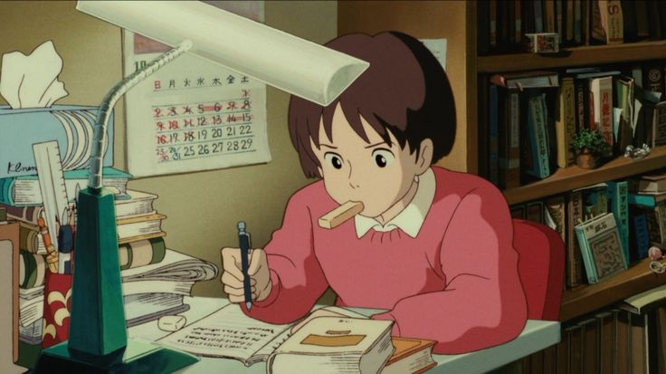

<!-- =====================================
     KEERTHANA'S LITTLE WORKSHOP
     A COZY ENGINEERING JOURNAL
===================================== -->

<h1>Welcome to My Little Workshop 🍂</h1>

<i>Mechanical Engineer · Developer · Curious Creator</i>

Building things, breaking things,
and learning how the world works.

  ﹏﹏﹏﹏﹏﹏﹏﹏﹏﹏ ✦ ﹏﹏﹏﹏﹏﹏﹏﹏﹏﹏

<!-- ABOUT ME -->

<h3 align="left">🍁 A Little About Me</h3>

Hey! I'm Keerthana, a Mechanical Engineering
student with a curiosity for technology,
design and creativity.

I love exploring the intersection of
engineering, programming and imagination.
From mechanical systems to digital worlds,
there's always something new to build.

  ﹏﹏﹏﹏﹏﹏﹏﹏﹏﹏ ✦ ﹏﹏﹏﹏﹏﹏﹏﹏﹏﹏

<table width="100%">
<tr>
<td width="55%" valign="middle">

<h3>🌿 Somewhere Between Dreams & Machines</h3>

I believe every little idea has the potential
to become something wonderful.

You'll probably find me somewhere between
a pile of engineering sketches, unfinished
projects, books and a cup of coffee.

I'm still figuring things out, one experiment
at a time. And honestly, that's the fun part.

<blockquote>
<i>
"A curious mind will always find a way
to build something extraordinary."
</i>
</blockquote>

</td>

<td width="45%" align="center" valign="middle">

</td>
</tr>
</table>

<!-- INTERESTS -->

<h3>⚙️ Things I Love Exploring</h3>

<ul>
<li>Mechanical Engineering</li>
<li>Robotics and Automation</li>
<li>CAD and 3D Modelling</li>
<li>Engineering Simulations</li>
<li>Web Development</li>
<li>Game Development</li>
</ul>

  ﹏﹏﹏﹏﹏﹏﹏﹏﹏﹏ ✦ ﹏﹏﹏﹏﹏﹏﹏﹏﹏﹏

<!-- TOOLBOX -->

<h3>🧰 My Little Toolbox</h3>

<!-- TECHNOLOGY ICONS WILL GO HERE -->

  ﹏﹏﹏﹏﹏﹏﹏﹏﹏﹏ ✦ ﹏﹏﹏﹏﹏﹏﹏﹏﹏﹏

<!-- PROJECTS -->

<h3>🏡 Things I've Been Building</h3>

<!-- PROJECT IMAGE 1 GOES HERE -->

<strong>KINETRA — Engineering in Motion</strong>

An interactive engineering playground.

<!-- PROJECT IMAGE 2 GOES HERE -->

<strong>ELEMENTA — Explore the Elements</strong>

An educational periodic table experience.

<!-- PROJECT IMAGE 3 GOES HERE -->

<strong>GEARBOUND — Mechanical Intelligence</strong>

A mechanical creature with interactive eyes and animated gears.

  ﹏﹏﹏﹏﹏﹏﹏﹏﹏﹏ ✦ ﹏﹏﹏﹏﹏﹏﹏﹏﹏﹏

<!-- CURRENTLY LEARNING -->

<h3>🌱 Currently Learning</h3>

<ul>
<li>HTML, CSS and JavaScript</li>
<li>AutoCAD and SolidWorks</li>
<li>Engineering Design and Simulation</li>
<li>Godot</li>
</ul>

  ﹏﹏﹏﹏﹏﹏﹏﹏﹏﹏ ✦ ﹏﹏﹏﹏﹏﹏﹏﹏﹏﹏

<!-- GITHUB STATISTICS -->

<h3>📖 My GitHub Journal</h3>

<!-- GITHUB STATISTICS WILL GO HERE -->

   ✦ 

<!-- PHILOSOPHY -->

<h3>☕ A Thought to Leave You With</h3>

<i>
"Learn something. Build something.
Make something that matters."
</i>

﹏﹏﹏ ✦ ﹏﹏﹏

<!-- FOOTER IMAGE GOES HERE -->

Thanks for visiting my little corner of the internet. 🤎

